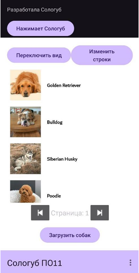
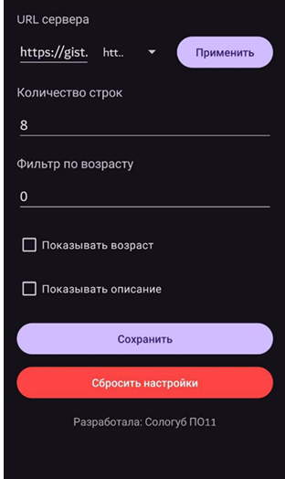

# Список собак — клиент-серверное приложение

Android-приложение для загрузки списка собак с удалённого сервера 
по JSON. Реализованы настройки отображения, пагинация и экспорт данных.

## Функционал
- Загрузка списка с сервера по кнопке
- Экран настроек: URL сервера, количество строк, фильтр по возрасту, 
  отображение полей
- Переключение линейного и сеточного вида
- Пагинация (вперёд/назад)
- Экран детальной информации о собаке
- Экспорт в CSV и отправка по email

## Стек
Java · Android SDK · Volley · Gson · Glide · OpenCSV · RecyclerView

## Скриншоты

