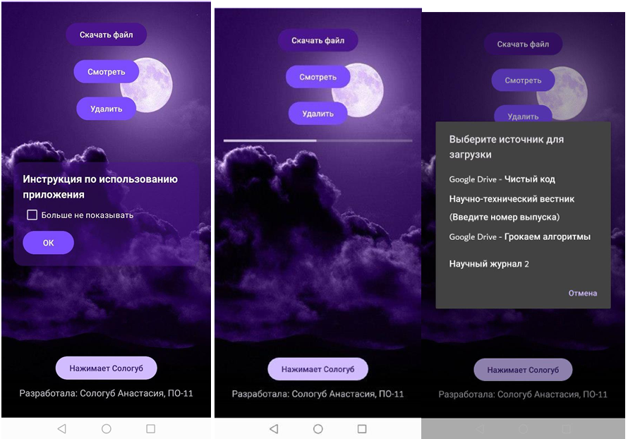

# Загрузчик файлов — асинхронная загрузка с сервера

Приложение для скачивания файлов с сервера с отображением прогресса, 
просмотром PDF и удалением.

## Функционал
- Асинхронная загрузка файла с прогресс-баром
- Просмотр загруженного PDF через FileProvider
- Удаление файла с устройства
- PopupWindow с инструкцией при первом запуске 
  (флаг «Больше не показывать» в SharedPreferences)

## Стек
Java · Android SDK · AsyncTask · HttpURLConnection · SharedPreferences · 
PopupWindow · FileProvider

## Скриншоты

