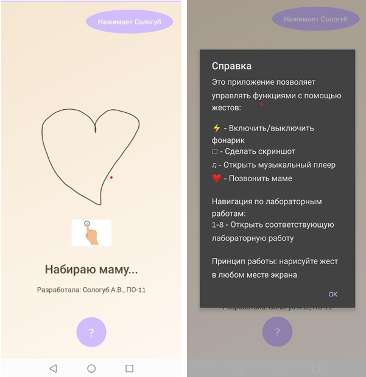

# Gesture App — пользовательские жесты

Приложение с областью рисования жестов и связным набором 
пользовательских жестов, каждый из которых запускает действие.

## Функционал
- Набор пользовательских жестов (фонарик, скриншот, музыкальный плеер, 
  звонок, переход к экрану)
- Справка по доступным жестам
- Информация об авторе и задании

## Стек
Java · Android SDK · Android Gesture API · AndroidX AppCompat

## Скриншоты

